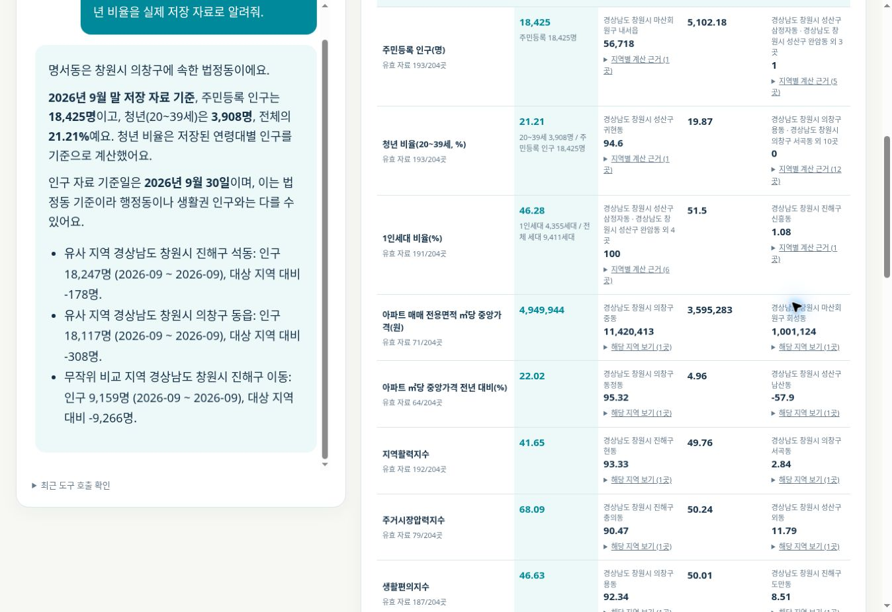
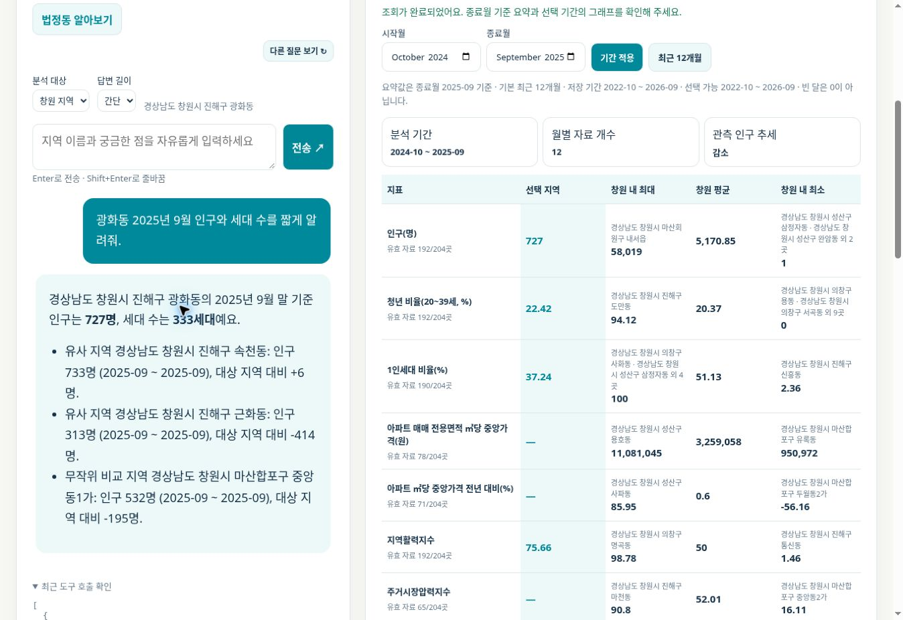
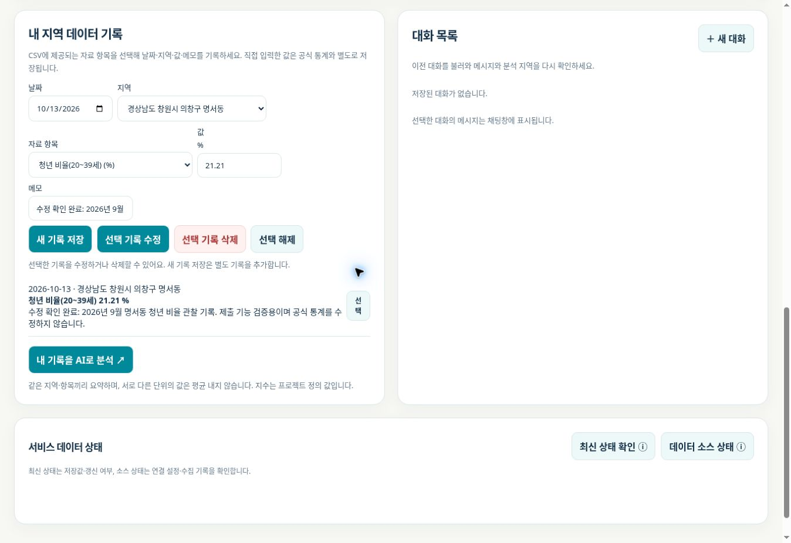
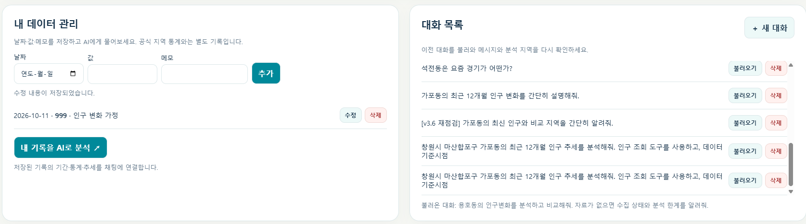
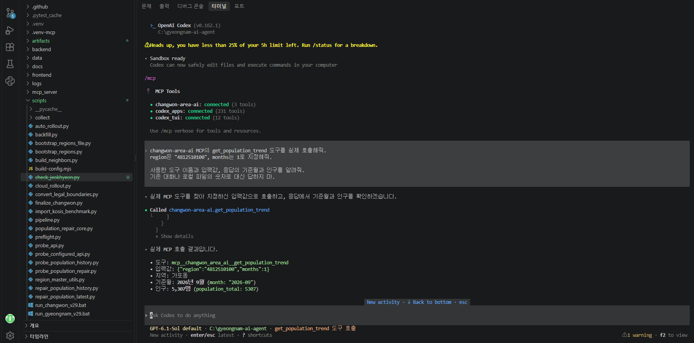

# 창원 생활 변화 AI 비서

창원시 204개 법정읍·면·동의 인구·주거·상권 자료를 질문으로 살펴보고, 개인 관찰 기록과 대화를 저장하는 AI 웹 서비스입니다. **이번 제출 범위는 창원시**이며 경남 전체 확장은 후속 과제입니다.

## 서비스와 제출 자료

- [홈페이지](https://gyeongnam-ai-agent.vercel.app/)
- [백엔드 API](https://gyeongnam-ai-agent.onrender.com/)
- [Swagger](https://gyeongnam-ai-agent.onrender.com/docs)
- [최종 제출 보고서](docs/SUBMISSION_REPORT.md): 요구사항 대응·실증 결과·한계
- [증빙 안내](docs/EVIDENCE.md): 실제 화면과 검증 JSON
- [데이터·지수 정의](docs/DATA_METHODS.md)
- [설정·운영·MCP 안내](docs/OPERATIONS.md)

## 구현 기능

| 미션 | 구현·검증 |
|---|---|
| 데이터 기반 AI 채팅 | 저장 요약을 시스템 지침에 주입하고 OpenAI Responses API로 답변. 로딩 표시·Markdown 렌더링·조회 도구 호출 |
| 개인 기록 CRUD | 날짜·지역·자료 항목·수치·메모의 추가/목록/수정/삭제. 공식 통계와 분리 저장 |
| 대화 저장·불러오기 | 자동 저장·대화 목록·특정 대화 메시지와 분석 지역 복원·삭제 |
| 배포·문서화 | FastAPI/Render, Vanilla HTML·CSS·JS/Vercel, Firestore, Swagger |
| 보너스: 도구·멀티채널 | Function Calling + Codex stdio MCP 실제 호출 |
| 보너스: 인사이트·UX | 4개 프로젝트 지수, 5종 선택형 추세 그래프, CSV·JSON 다운로드, 다크 모드 |

기술: Python 3.10+, FastAPI, Pydantic, firebase-admin, OpenAI, python-dotenv, MCP Python SDK. 프론트는 프레임워크 없이 구현했습니다.

## 데이터 범위와 검증

- 인구 분석 기간: **2022-10~2026-09, 48개월**. 창원 204지역 × 48개월 = **9,792개 월별 문서**.
- 인구·세대 총계: 48개월 시·5개 구 기준 대조 통과. 모든 문서에 모든 지표가 있다는 뜻은 아닙니다.
- 비인구 감사 대상 20,196개 소스·지역·월 조합: 저장 7,871 / 정상 조회 후 자료 없음 12,325 / 미조회 0.
- 매매·전월세는 월별 거래, 공동주택·건축물·상권은 현재 스냅샷입니다. 현재 스냅샷을 과거 48개월로 복제하지 않습니다.
- 4개 지수는 공식 통계가 아닌 같은 월 창원 지역 간 상대평가입니다. 구성자료 부족 시 빈 값입니다.
- 실제 0과 결측 `—`를 구분합니다. 소규모 법정동은 비율의 분자·분모를 같이 표시합니다.
- 최신 전체 자동 테스트: **178개 통과**. 실제 개인 API CRUD·소유자 분리·대화 API, 홈페이지 저장/수정/복원, MCP 통신을 별도로 검증했습니다.

## 로컬 실행 (Windows PowerShell)

```powershell
python -m venv .venv
.\.venv\Scripts\Activate.ps1
python -m pip install -r requirements.txt -r requirements-dev.txt
Copy-Item .env.example .env
# .env를 실제 설정으로 채웁니다. 키는 커밋하지 않습니다.
python -m uvicorn backend.main:app --reload
```

Swagger: `http://127.0.0.1:8000/docs`. 별도 터미널에서:

```powershell
$env:API_BASE_URL="http://127.0.0.1:8000"
node scripts/build-config.mjs
python -m http.server 5500 -d frontend
```

프론트: `http://127.0.0.1:5500`. Render가 아니라 로컬 API를 사용할 때 Firebase 익명 인증·서비스 계정·CORS 설정도 필요합니다. 운영 DB를 사용하는 CRUD 실습은 본인의 개인 기록만 변경합니다. `monthly_data` 원자료를 수정하지 않습니다.

## 최소 환경변수

| 변수 | 위치·역할 |
|---|---|
| `OPENAI_API_KEY` | 백엔드만: GPT 호출 비밀키 |
| `OPENAI_MODEL` / `OPENAI_MAX_OUTPUT_TOKENS` | 모델·출력 길이 제한. 기본값은 코드 설정 참고 |
| `FIREBASE_SERVICE_ACCOUNT_JSON` | 백엔드·수집 Actions: 서비스 계정 JSON 내용 또는 파일 경로 |
| `FIREBASE_PROJECT_ID` | 백엔드: 서비스 계정·웹 앱과 동일 프로젝트 |
| `FIREBASE_WEB_API_KEY` / `FIREBASE_AUTH_DOMAIN` | 백엔드가 웹 인증 설정을 제공. 서비스 계정 개인키와 다름 |
| `USE_MEMORY_DB=false` / `DEMO_SEED_ON_START=false` | 제출·운영: 실제 Firestore, 데모 자료 제외 |
| `ANALYSIS_SCOPE_PREFIX=4812` | 창원 범위 |
| `ALLOWED_ORIGINS` | Vercel 주소 및 필요한 로컬 주소를 쉼표로 구분 |
| `API_BASE_URL` | Vercel 빌드: `https://gyeongnam-ai-agent.onrender.com` |
| `ADMIN_REFRESH_TOKEN` | 서버 관리자 갱신용 비밀값. 프론트에 넣지 않음 |
| `DATA_GO_KR_SERVICE_KEY` / 소스별 설정 | 수집 Actions용. 상세 예시는 [운영 안내](docs/OPERATIONS.md) |

## 필수 API와 인증

| 기능 | 엔드포인트 |
|---|---|
| 기록 추가·목록·요약 | `POST /api/data`, `GET /api/data`, `GET /api/data/summary` |
| 기록 수정·삭제 | `PUT /api/data/{doc_id}`, `DELETE /api/data/{doc_id}` |
| 대화 저장·목록 | `POST /api/conversations`, `GET /api/conversations` |
| 대화 불러오기·삭제 | `GET /api/conversations/{doc_id}`, `DELETE /api/conversations/{doc_id}` |
| AI | `POST /api/chat` |

개인 API는 Firebase ID 토큰을 `Authorization: Bearer <ID_TOKEN>`으로 검증하고 `owner_uid`로 제한합니다. `{doc_id}`는 미션의 `{id}`와 같은 문서 ID입니다. 홈페이지는 익명 인증을 자동 연결합니다. 공개 지역 통계는 인증 없이 조회할 수 있습니다. 다른 브라우저나 브라우저 저장정보 삭제 후에는 기존 익명 기록을 복구하지 못할 수 있습니다.

## 도구 호출 흐름과 MCP

예: “명서동의 2026년 9월 인구와 청년 비율” → 기준월이 명시되어 `get_region_month` 선택 → Firestore 해당 월 조회 → 18,425명·청년 3,908명으로 계산 → 21.21% 답변 → 대화 자동 저장. 도구 이름·입력은 화면의 ‘최근 도구 호출 확인’에서 확인합니다.

MCP: Codex → 로컬 `mcp_server/remote_server.py`(stdio) → Render 읽기 전용 통계 API → Firestore. 웹과 같은 저장값을 사용하며 Firebase 개인키를 MCP에 넣지 않습니다. `/mcp` 원격 HTTPS 서버를 배포한 것은 아닙니다.

```powershell
python scripts/verify_remote_mcp.py
codex mcp add changwon-area-ai --env MCP_API_BASE_URL=https://gyeongnam-ai-agent.onrender.com -- "C:\gyeongnam-ai-agent\.venv\Scripts\python.exe" "C:\gyeongnam-ai-agent\mcp_server\remote_server.py"
codex mcp list
```

가포동 `get_population_trend(region="4812510100", months=1)`와 `get_region_summary`의 실제 결과는 **2026-09 / 5,307명**으로 일치합니다. 사용자의 Codex 호출 화면과 독립 MCP ClientSession 호출 결과를 함께 증빙합니다.

## 제출 스크린샷

질문·답변과 데이터 요약(실제 대화 불러오기 후):



지정월 질문 전체와 답변·요약:



개인 기록 저장·수정 후 새로고침 보존:



대화 불러오기 버튼·복원 상태:



Codex MCP 실제 호출:



## 테스트·주의점

```powershell
python -m pytest -q
node --check frontend/app.js
```

Render 무료 서비스의 첫 요청·재배포 때 지연이나 일시 오류가 있을 수 있어 로딩·대기·오류 안내를 제공합니다. 장시간 부하·항상 가용성을 보장한 것은 아닙니다. 자동 갱신의 성공 여부는 실행 기록을 확인해야 하며 과거 수집 완료를 향후 갱신 성공으로 간주하지 않습니다. 평가자가 비공개 저장소를 열 수 있는지 확인한 뒤, 홈페이지 주소·저장소·보고서와 증빙을 제출하세요.
